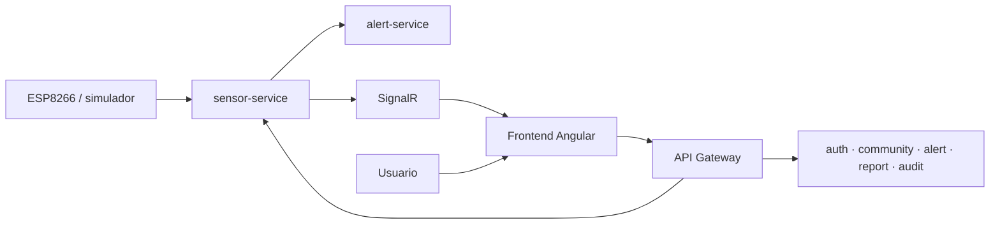

# ClimGuard
## Sistema Web de Monitoreo y Alerta Temprana para Riesgos Climáticos

**Curso:** Desarrollo Web  
**Tecnologías:** Angular 22, .NET 10 (gateway, community, sensor), NestJS (auth), Spring Boot (alert), FastAPI (report, audit), PostgreSQL 16, SQL Server 2022, MongoDB 7, SignalR, Docker Compose, Kubernetes (K3s)  
**Versión:** 3.0 (vigente, ClimGuard 4.1)

---

# DOC-01. Introducción al Proyecto

### Historial de versiones
| Versión | Fecha | Cambios |
|---|---|---|
| 1.0 | Agosto 2026 | Introducción del sistema con Angular, API .NET, SQL Server y SignalR, con datos simulados. |
| 3.0 | Noviembre 2026 | Alcance de ClimGuard 4.1: microservicios, sensores físicos ESP8266, reglas de alerta, OAuth, reportes PDF y despliegue en K3s. |

## 1. Introducción

Los fenómenos climáticos representan una amenaza constante para las comunidades, especialmente aquellas ubicadas en zonas rurales donde el acceso oportuno a información puede ser limitado. La falta de un sistema que centralice el monitoreo de variables ambientales dificulta la detección temprana de condiciones de riesgo, retrasando la toma de decisiones ante posibles emergencias.

**ClimGuard** es un sistema web de monitoreo y alerta temprana para riesgos climáticos que permite visualizar en tiempo real las lecturas provenientes de sensores ambientales, detectar automáticamente condiciones de riesgo mediante reglas de alerta configurables, generar alertas, administrar comunidades, sensores y usuarios, así como mantener un historial de eventos para facilitar el seguimiento de incidentes.

El sistema comenzó en las Fases 1 y 2 como una aplicación Angular con una API .NET, SQL Server y SignalR que trabajaba con datos simulados. En la Fase 3 se reorganizó en microservicios detrás de un API Gateway, cada uno con su propia base de datos, y en la Fase 4 incorporó el inicio de sesión con Google y GitHub y el despliegue en Kubernetes (K3s). La versión 4.1 recibe lecturas de sensores físicos ESP8266 y de sensores simulados por el mismo proceso.

---

# 2. Planteamiento del Problema

Las comunidades expuestas a riesgos climáticos requieren información confiable y oportuna para responder adecuadamente ante eventos como inundaciones, tormentas, sequías, heladas o incendios forestales. Sin embargo, muchos sistemas de monitoreo presentan limitaciones relacionadas con la centralización de la información, la generación automática de alertas, la administración de sensores y el almacenamiento histórico de los eventos registrados.

La ausencia de una plataforma que integre estas funcionalidades dificulta el monitoreo continuo de las condiciones ambientales y limita la capacidad de reacción de los responsables de la gestión del riesgo.

---

# 3. Justificación

El desarrollo de ClimGuard permitió construir una plataforma capaz de centralizar el monitoreo de variables climáticas, automatizar la generación de alertas y facilitar la gestión de eventos mediante una arquitectura moderna, escalable y preparada para futuras integraciones con dispositivos IoT.

En la Fase 4 el sistema pasó a ejecutarse en Kubernetes (K3s), con almacenamiento persistente, configuración y secretos separados del código y comprobaciones de salud de cada servicio.

Asimismo, el uso de Docker Compose facilita el despliegue reproducible del sistema en distintos entornos, reduciendo tiempos de configuración y simplificando la instalación del proyecto.

Además de cumplir con los objetivos académicos del curso, el sistema queda preparado para evolucionar hacia una solución IoT capaz de trabajar con sensores físicos y microcontroladores.

---

# 4. Objetivo General

Desarrollar un sistema web que permita monitorear variables climáticas en tiempo real, detectar automáticamente condiciones de riesgo, generar alertas tempranas y administrar el historial de eventos mediante una plataforma segura, escalable, con comunicación en tiempo real y preparada para integrarse con sensores físicos.

---

# 5. Objetivos Específicos

- Administrar comunidades, sensores y usuarios del sistema.
- Visualizar en tiempo real las variables climáticas provenientes de sensores simulados o físicos.
- Detectar automáticamente condiciones de riesgo mediante reglas de alerta configurables (intervalos de peligro por tipo de sensor; en el análisis original, *umbrales*).
- Administrar las reglas de alerta y los tipos de fenómeno utilizados para la generación automática de alertas.
- Generar alertas clasificadas por niveles de peligro.
- Mostrar las alertas en tiempo real mediante SignalR.
- Registrar las acciones relevantes realizadas por los usuarios mediante un módulo de bitácora.
- Mantener un historial de lecturas y eventos registrados.
- Permitir el inicio de sesión con cuentas de Google y GitHub (OAuth 2.0 / OpenID Connect).
- Generar reportes en PDF de comunidades, sensores, lecturas, alertas y estadísticas.
- Desplegar el sistema en un clúster Kubernetes con HTTPS, almacenamiento persistente y comprobaciones de salud.
- Diseñar una arquitectura escalable que facilite la incorporación de nuevas comunidades, sensores y futuras tecnologías IoT.

---

# 6. Alcance

ClimGuard permite administrar múltiples comunidades y los sensores asociados a cada una de ellas, mostrando información climática en tiempo real mediante un panel de monitoreo.

El sistema registra automáticamente las lecturas enviadas por sensores físicos (ESP8266) y las generadas para los sensores simulados, evalúa las reglas de alerta configuradas para cada tipo de sensor y genera alertas cuando se detectan condiciones de riesgo.

Asimismo, incorpora un Centro de Alertas para visualizar los eventos activos, un módulo de Bitácora para registrar acciones realizadas por los usuarios y diferentes módulos administrativos para la gestión de usuarios, comunidades, sensores, reglas de alerta y tipos de fenómeno, además de un módulo de reportes PDF y el inicio de sesión con Google y GitHub.

Desde la Fase 4 el sistema combina sensores físicos y simulados: cada sensor indica su origen y ambos tipos siguen el mismo proceso de registro, evaluación y notificación.

---

# 7. Tecnologías Utilizadas

| Área | Tecnología |
|---|---|
| Frontend | Angular 22 |
| API Gateway | ASP.NET Core 10 + YARP |
| Microservicios | NestJS (auth), ASP.NET Core 10 (community, sensor), Spring Boot 3.4 (alert), FastAPI (report, audit) |
| Bases de datos | PostgreSQL 16, SQL Server 2022, MongoDB 7 |
| Tiempo real | SignalR |
| Autenticación | JWT, OAuth 2.0 / OpenID Connect (Google, GitHub) |
| Contenedores y orquestación | Docker, Docker Compose (desarrollo), Kubernetes K3s (producción) |
| Dispositivos | ESP8266 |
| Control de versiones | Git y GitHub (con integración continua en GitHub Actions) |

En las Fases 1 y 2 la pila era Angular 20, una API .NET 10, SQL Server 2022, SignalR y Docker Compose.

---

# 8. Arquitectura General

ClimGuard 4.1 está compuesto por una aplicación web Angular, un API Gateway y seis microservicios (autenticación, comunidades, sensores, alertas, reportes y auditoría), cada uno con su propia base de datos.

El gateway es el único punto de entrada: valida el token y reenvía cada petición al microservicio correspondiente. El sensor-service registra las lecturas (de dispositivos o del simulador), las publica por SignalR y solicita al alert-service evaluarlas contra las reglas.

Detalle: [DOC-13 Arquitectura](DOC-13-Arquitectura%20de%20Software.md).

La previsión de las primeras fases de incorporar sensores físicos sin cambiar la lógica principal se cumplió en la Fase 4: el dispositivo usa la misma API de lecturas que el resto del sistema.

---

# 9. Organización de la Documentación

La documentación del proyecto se encuentra organizada en documentos independientes que describen cada una de las etapas del desarrollo del sistema, incluyendo requerimientos funcionales y no funcionales, reglas de negocio, historias de usuario, casos de uso, diagramas UML, arquitectura, diseño de base de datos, especificación de la API REST y despliegue mediante Docker.

Cada documento mantiene trazabilidad con los componentes implementados, permitiendo relacionar los requerimientos definidos con la solución desarrollada.

El índice de la documentación vigente y de los registros históricos de cada fase está en [docs/README.md](README.md).
