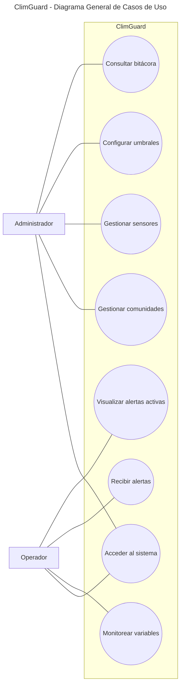
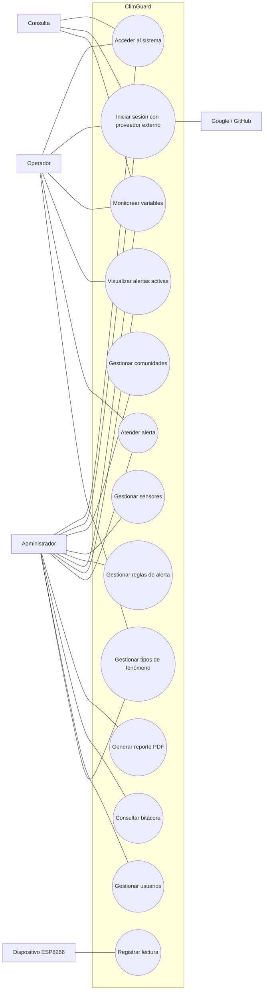

# ClimGuard
## Diagrama General de Casos de Uso

| Proyecto | ClimGuard |
|-----------|-----------|
| Documento | Diagrama General de Casos de Uso |
| Código | DOC-06 |
| Versión | 3.0 |
| Estado | Vigente (ClimGuard 4.1) |

### Historial de versiones
| Versión | Fecha | Cambios |
|---|---|---|
| 1.0 | Agosto 2026 | Diagrama de las Fases 1 y 2 (Administrador y Operador, UC1 a UC8). |
| 3.0 | Noviembre 2026 | Diagrama vigente de ClimGuard 4.1 con los roles, actores externos y casos de uso CU-009 a CU-013. |

> El primer diagrama es el original de las Fases 1 y 2; el vigente está al final.

---

# Objetivo

El presente documento presenta el diagrama general de casos de uso implementados en ClimGuard, mostrando la interacción entre los actores del sistema y las funcionalidades disponibles para cada uno de ellos.

# Diagrama original (Fases 1 y 2)

# Diagrama vigente (ClimGuard 4.1)

| Actor | Descripción |
|---|---|
| Administrador | Gestiona todo el sistema |
| Operador | Monitorea, atiende alertas y gestiona tipos de fenómeno |
| Consulta | Solo lectura del panel, mapa, sensores, comunidades y reglas |
| Dispositivo ESP8266 | Envía lecturas con una cuenta de servicio de rol Operador |
| Google / GitHub | Proveedores de identidad externos |
