# ClimGuard
## Diagramas de Actividades

| Proyecto | ClimGuard |
|-----------|-----------|
| Documento | Diagramas de Actividades |
| Código | DOC-07 |
| Versión | 3.0 |
| Estado | Vigente (ClimGuard 4.1) |

### Historial de versiones
| Versión | Fecha | Cambios |
|---|---|---|
| 1.0 | Agosto 2026 | DA-001 a DA-008 (Fases 1 y 2). |
| 3.0 | Noviembre 2026 | DA-009 a DA-011 (inicio de sesión externo, procesamiento de lecturas físicas y simuladas, generación de reportes); nota de vigencia en DA-004. |

> DA-001 a DA-008 se conservan como se diseñaron.

---

# Objetivo

El presente documento presenta los diagramas de actividades correspondientes a los casos de uso implementados en ClimGuard, mostrando el flujo de acciones, decisiones y resultados de los principales procesos del sistema.

# DA-001 – Acceder al sistema
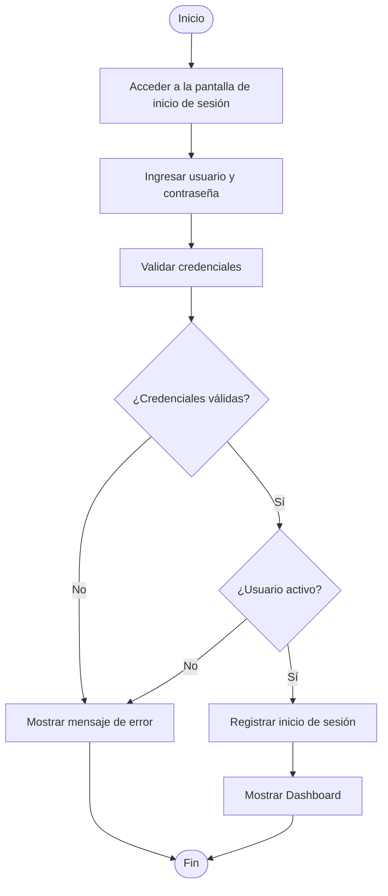

# DA-002 - Gestionar comunidades 
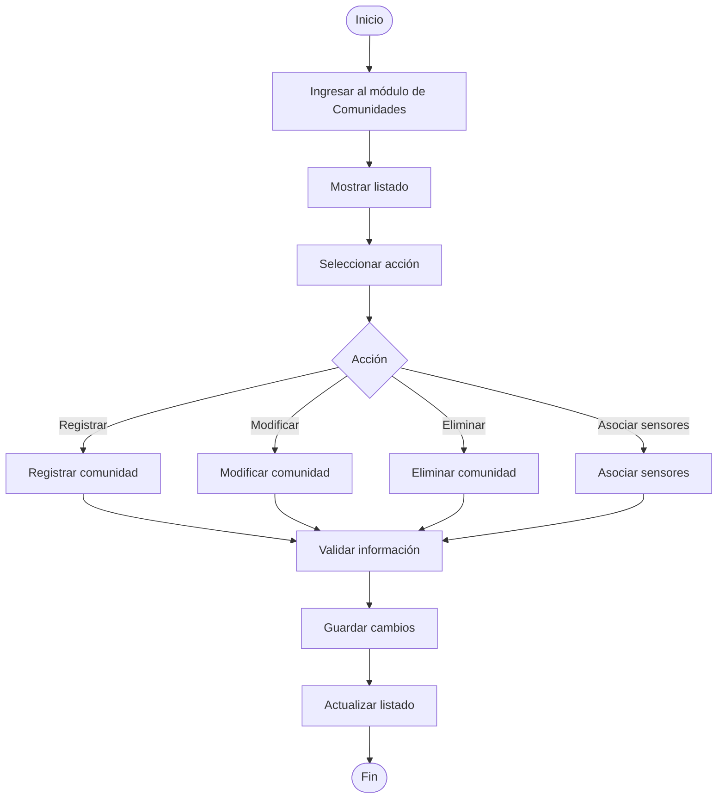

# DA-003 - Gestionar sensores
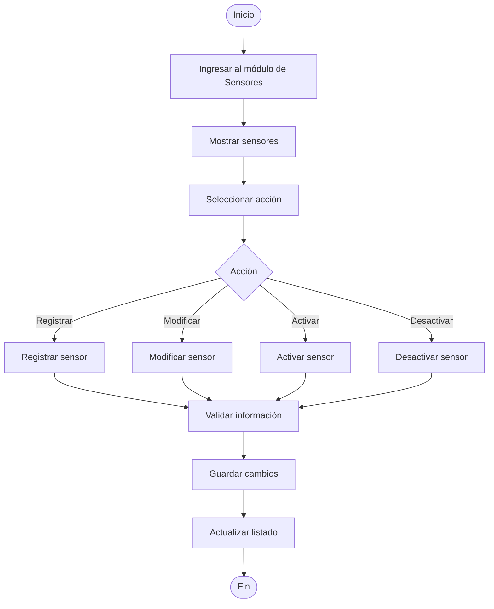

# DA-004 - Configurar umbrales

> **Estado en ClimGuard 4.1:** los umbrales se gestionan como reglas de alerta (CU-013).
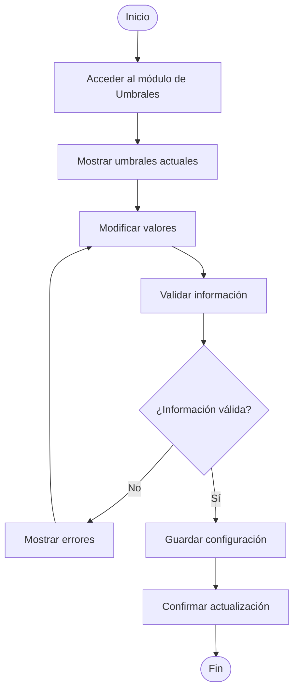

# DA-005 - Monitorear variables climáticas
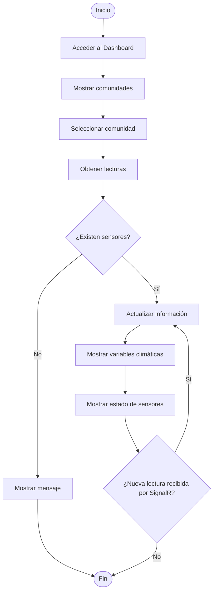

# DA-006 - Recibir alertas
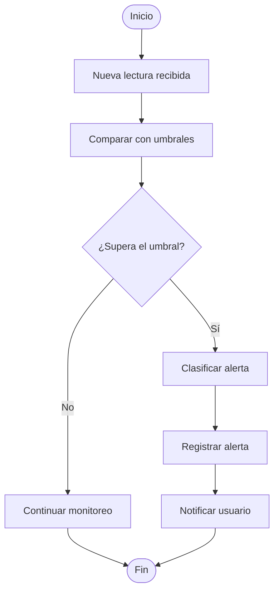

# DA-007 – Visualizar alertas activas

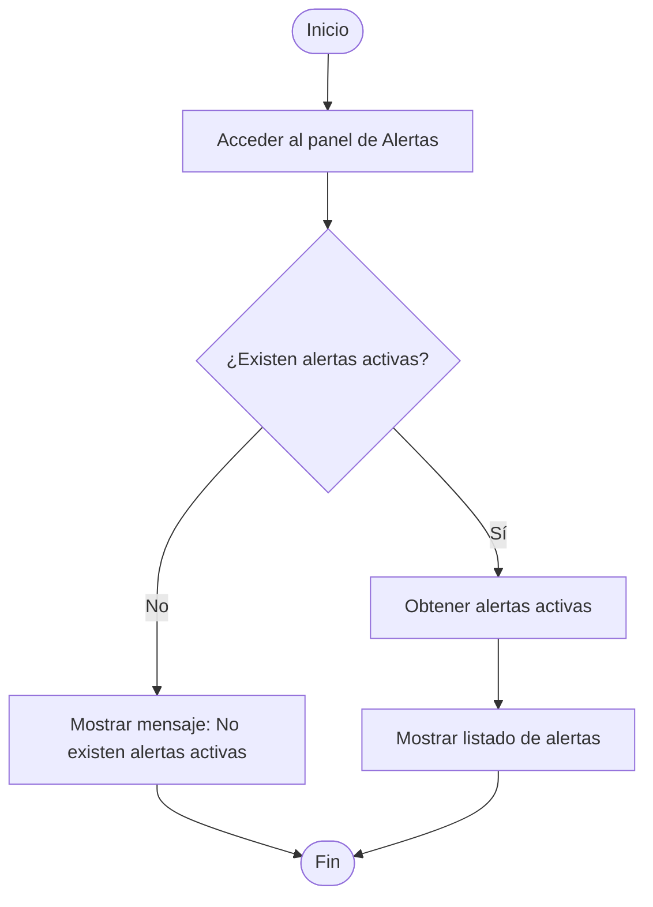

# DA-008 - Consultar bitácora
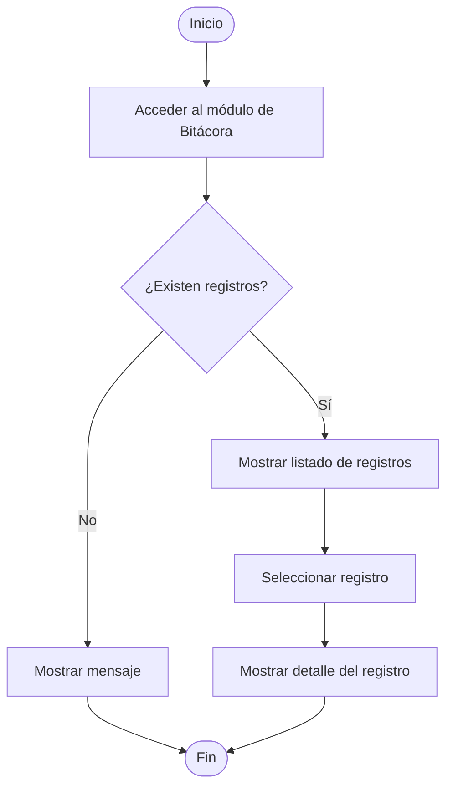

---

# DA-009 – Iniciar sesión con un proveedor externo
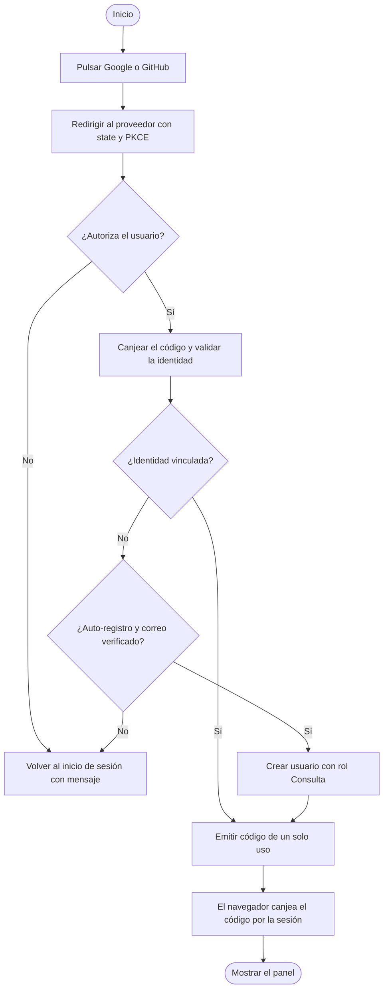

---

# DA-010 – Procesar una lectura (sensor físico o simulado)
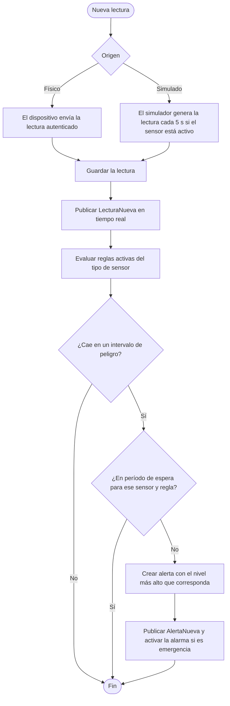

---

# DA-011 – Generar un reporte PDF
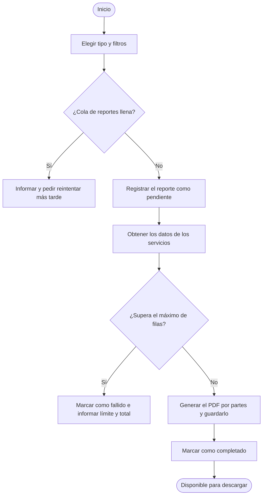
