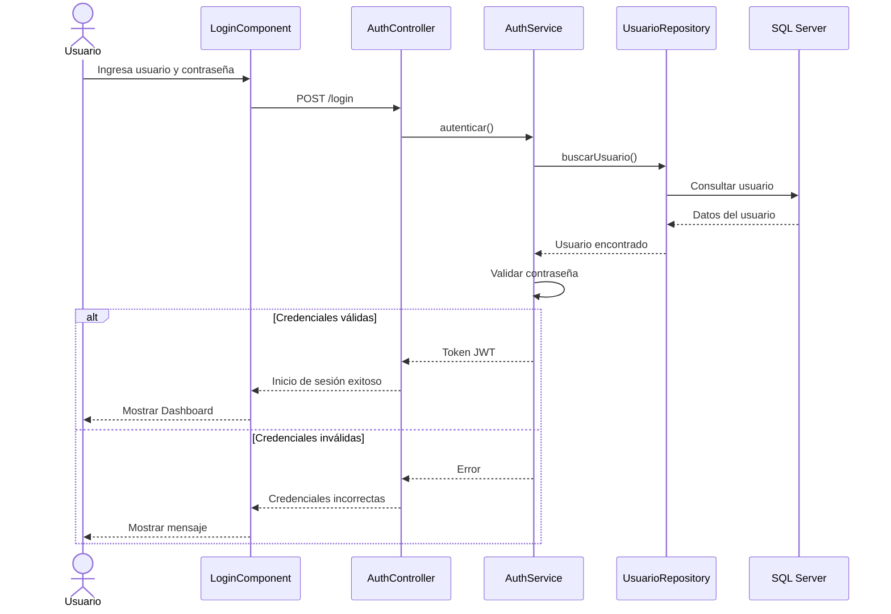
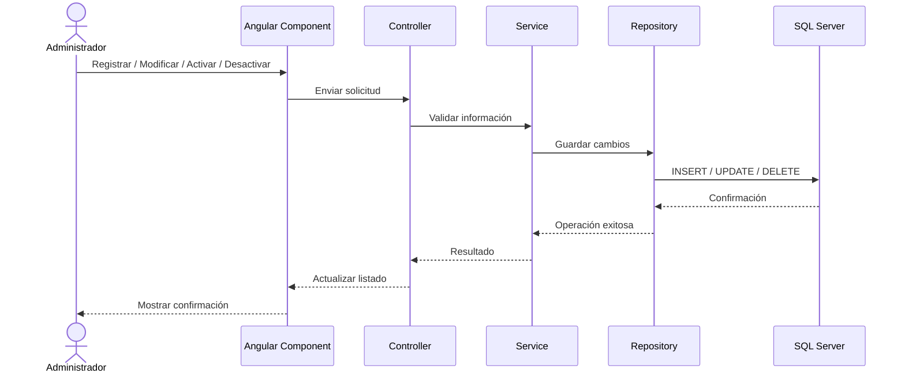
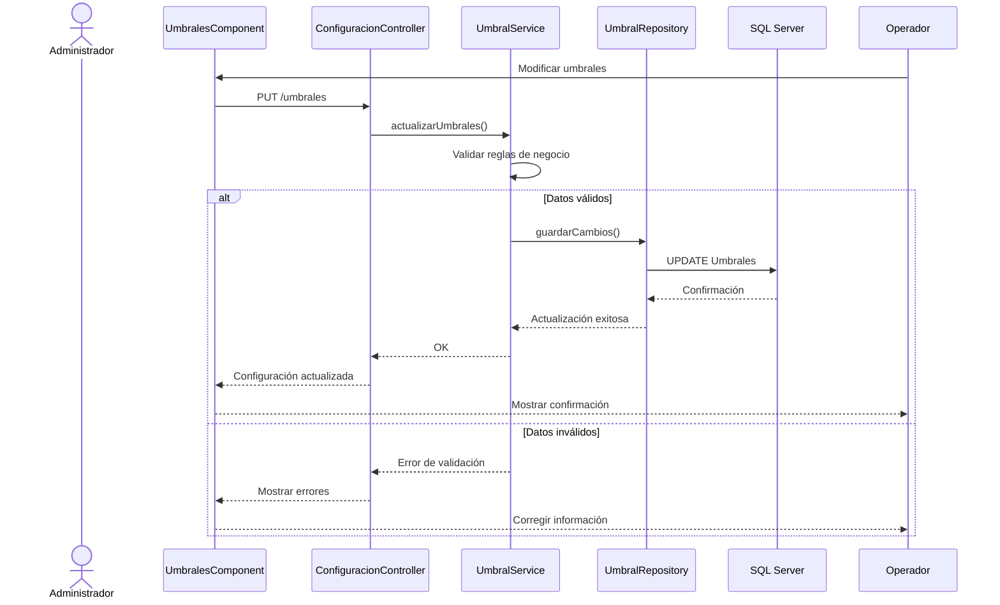
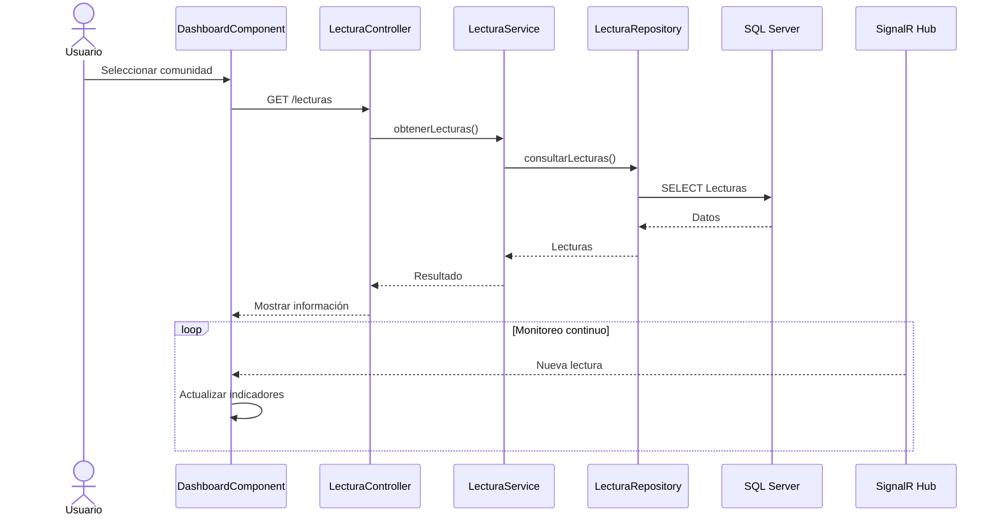
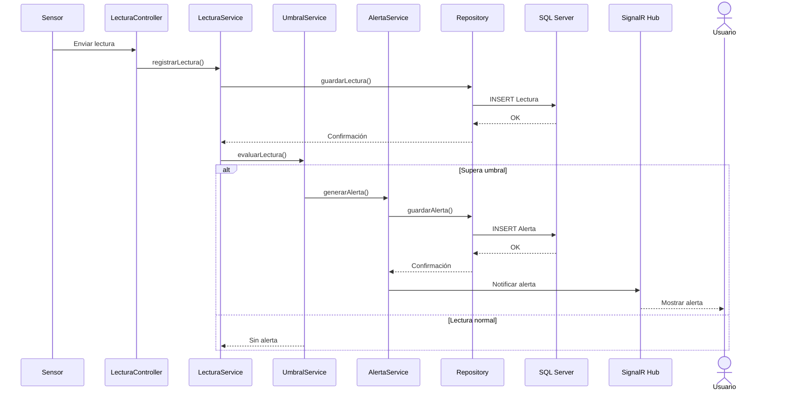
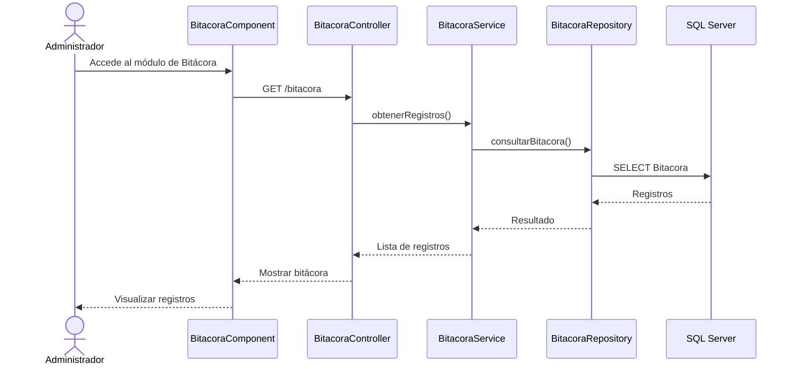
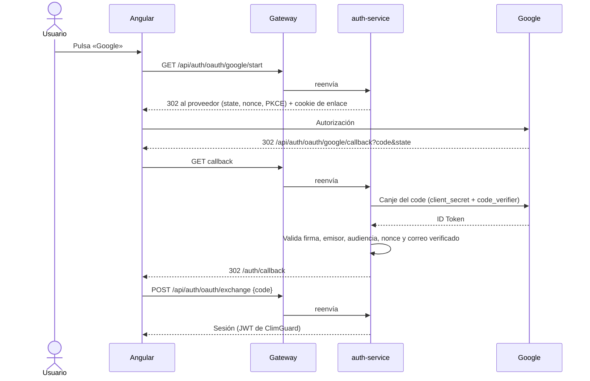
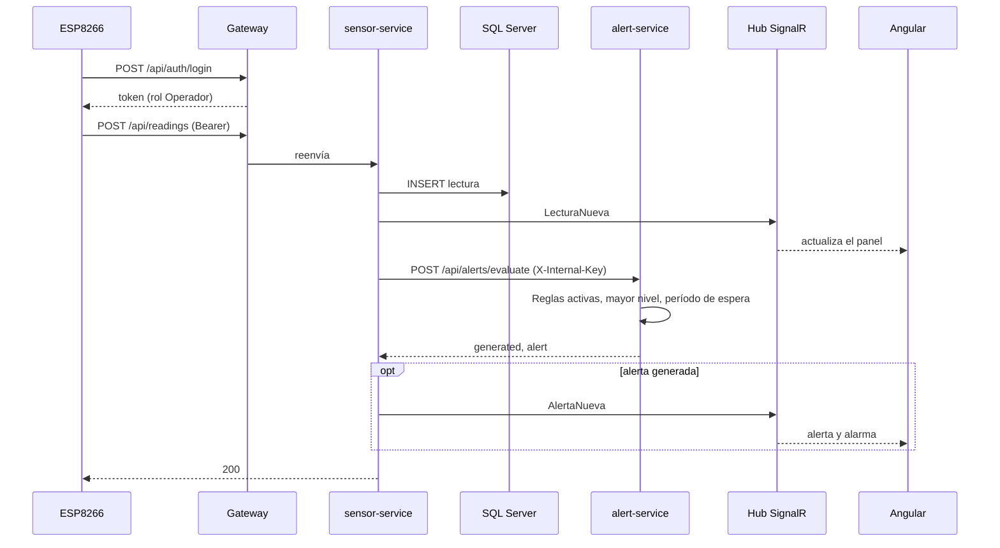
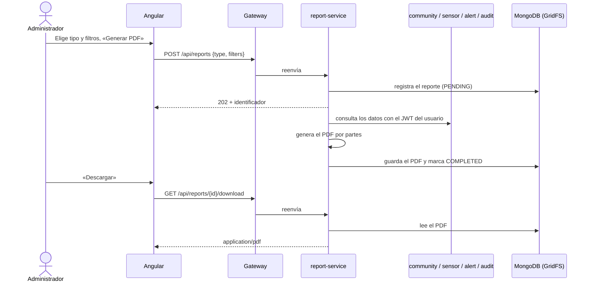

# ClimGuard
## Diagramas de Secuencia

| Proyecto | ClimGuard |
|-----------|-----------|
| Documento | Diagramas de Secuencia |
| Código | DOC-08 |
| Versión | 3.0 |
| Estado | Vigente (ClimGuard 4.1) |

### Historial de versiones
| Versión | Fecha | Cambios |
|---|---|---|
| 1.0 | Agosto 2026 | DS-001 a DS-006 sobre la API monolítica de la Fase 2. |
| 3.0 | Noviembre 2026 | DS-007 a DS-009 sobre los microservicios de ClimGuard 4.1. |

> DS-001 a DS-006 muestran los componentes de la API monolítica de la Fase 2 (controladores, servicios y repositorios en un solo proceso, con SQL Server) y se conservan como diseño de esa etapa. Los diagramas vigentes son DS-007 a DS-009.

---

# Objetivo

El presente documento describe la secuencia de interacción entre los actores y los componentes del sistema ClimGuard durante la ejecución de los principales casos de uso implementados.

Cada diagrama muestra el intercambio de mensajes entre la interfaz web, la API REST, los servicios de negocio, el acceso a datos y la base de datos SQL Server.

# DS-001- Acceder al sistema

# DS-002- Administración de comunidades y sensores

# DS-003- Configurar umbrales

# DS-004- Monitorear variables climática

# DS-005 – Recibir alertas

# DS-006 - Consultar bitácora

---

# DS-007 – Inicio de sesión con Google (ClimGuard 4.1)

---

# DS-008 – Lectura de un sensor físico y generación de alerta (ClimGuard 4.1)

---

# DS-009 – Generación de un reporte PDF (ClimGuard 4.1)

