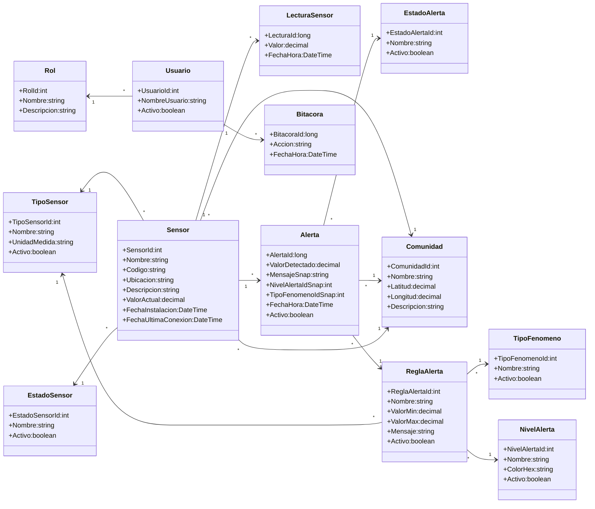
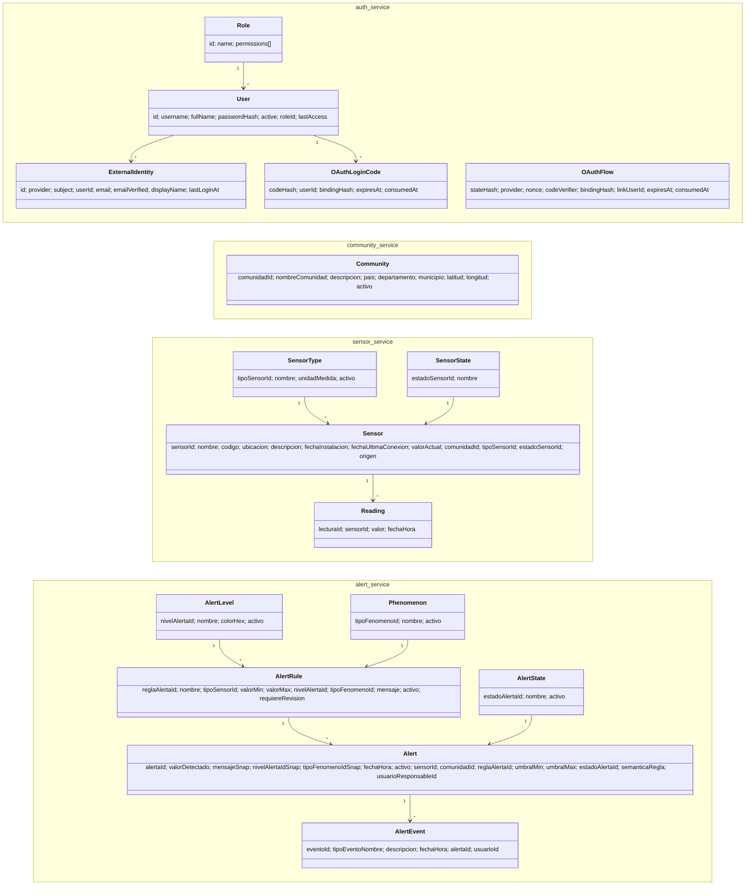

# ClimGuard
## Diagrama de clases de la Fase 2 (monolito)

| Proyecto | ClimGuard |
|-----------|-----------|
| Documento | Diagrama de Clases |
| Código | DOC-09 |
| Versión | 3.0 |
| Estado | Vigente (ClimGuard 4.1) |

### Historial de versiones
| Versión | Fecha | Cambios |
|---|---|---|
| 1.0 – 2.0 | Agosto – octubre 2026 | Clases del dominio del monolito de la Fase 2 (con ReglaAlerta en lugar de umbrales en la 2.0). |
| 3.0 | Noviembre 2026 | Clases vigentes por microservicio (ClimGuard 4.1). |

> Las secciones originales describen el modelo de la Fase 2 (una sola base SQL Server) y se conservan como registro. El modelo vigente está en la sección final.

---

# Objetivo

El presente documento describe el modelo de clases implementado en la versión final de ClimGuard. El diagrama representa las entidades del dominio, catálogos y relaciones persistidas en la base de datos, permitiendo comprender la organización de la información utilizada por el sistema para el monitoreo climático, la simulación de lecturas, la generación de alertas y la administración de los diferentes módulos.

A diferencia de las versiones iniciales, el modelo incorpora la persistencia de lecturas históricas mediante la entidad **LecturaSensor** y el uso de **snapshots** dentro de las alertas, con el propósito de conservar la información que dio origen a cada evento aun cuando las reglas sean modificadas posteriormente.

---

# Diagrama de Clases

---

# Observaciones

- El modelo representa exclusivamente las entidades del dominio persistidas en la base de datos.
- La generación de lecturas es realizada automáticamente por un **Background Service**, el cual crea registros en **LecturaSensor** y actualiza el valor actual de cada sensor.
- La evaluación de reglas se realiza utilizando la entidad **ReglaAlerta**, sustituyendo el modelo anterior basado en umbrales independientes.
- La entidad **Alerta** almacena snapshots del mensaje, nivel de alerta y tipo de fenómeno (`MensajeSnap`, `NivelAlertaIdSnap` y `TipoFenomenoIdSnap`), garantizando la integridad histórica de cada alerta aun cuando las reglas sean modificadas posteriormente.
- Las entidades principales incorporan auditoría mediante los campos de usuario y fecha de creación/modificación.
- Los componentes de infraestructura (Controllers, Repositories, Background Services, SignalR, Docker y Base de Datos) no forman parte del modelo de clases, ya que pertenecen a la arquitectura de implementación.

---

# Diagrama de clases vigente (ClimGuard 4.1)
Cada microservicio tiene su propio modelo; las referencias entre servicios son identificadores, no objetos compartidos.

Además del modelo persistido, los servicios Python (report-service y audit-service) trabajan con documentos de MongoDB (DOC-10 §10.5) y el sensor-service mantiene el estado del simulador en memoria (`SimulationState`). La lógica de evaluación de reglas vive en `RuleEvaluator` (alert-service) y su espejo `peligro.ts` (frontend).
