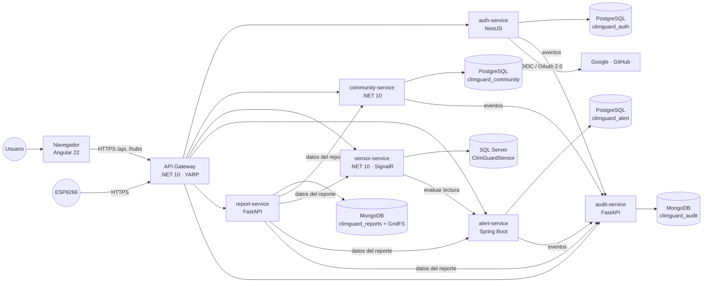
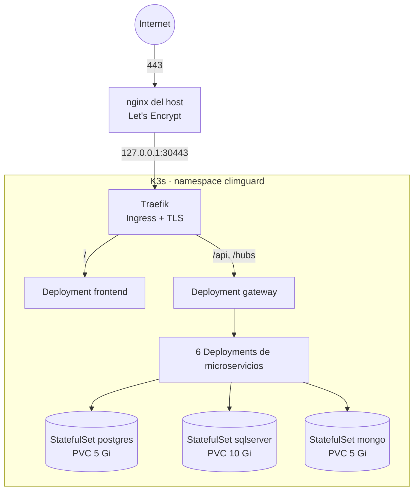

# ClimGuard
## Arquitectura del Sistema

| Proyecto | ClimGuard |
|-----------|-----------|
| Documento | Arquitectura del Sistema |
| Código | DOC-13 |
| Versión | 3.0 |
| Estado | Vigente (ClimGuard 4.1) |

### Historial de versiones
| Versión | Fecha | Cambios |
|---|---|---|
| 1.0 – 2.0 | Agosto – octubre 2026 | Arquitectura por capas del monolito de la Fase 2: Angular 20, ASP.NET Core Web API, `BackgroundService` de simulación, SignalR y SQL Server 2022 en Docker. Ver [fases/fase-1-2](fases/fase-1-2/README.md). |
| 3.0 | Noviembre 2026 | Microservicios con API Gateway (Fase 3), autenticación OAuth 2.0/OIDC y despliegue en Kubernetes K3s (Fase 4), sensores físicos ESP8266. |

---

# Objetivo
Describir la arquitectura de ClimGuard 4.1: sus componentes, cómo se comunican, cómo se protegen y cómo se despliegan.

# 1. Vista general



ClimGuard pasó de un monolito (Fases 1-2) a **siete servicios** independientes: un gateway y seis microservicios, cada uno con su propia base de datos. El frontend es una aplicación Angular servida como archivos estáticos.

# 2. Componentes

| Componente | Tecnología | Responsabilidad | Datos |
|---|---|---|---|
| Frontend | Angular 22, SignalR, Leaflet | Interfaz por roles, panel en tiempo real, mapa, formularios | — |
| API Gateway | ASP.NET Core 10 + YARP 2.3 | Único punto de entrada: enruta `/api/*` y `/hubs/*`, valida el JWT, CORS, límites por IP | — |
| auth-service | NestJS 11 + TypeORM | Login local, OAuth 2.0/OIDC (Google, GitHub), emisión de JWT, usuarios y roles | PostgreSQL |
| community-service | ASP.NET Core 10 + EF Core | Comunidades (ubicación, departamento, municipio) | PostgreSQL |
| sensor-service | ASP.NET Core 10 + EF Core + SignalR | Sensores, lecturas, estadísticas, simulador, hub `/hubs/monitoreo` | SQL Server |
| alert-service | Java 21 + Spring Boot 3.4 + Hibernate | Reglas, evaluación de lecturas, alertas y eventos, catálogos | PostgreSQL |
| report-service | Python 3.12 + FastAPI + Jinja2 + WeasyPrint | Reportes PDF por trozos, historial, descarga, indicadores del panel | MongoDB + GridFS |
| audit-service | Python 3.12 + FastAPI | Bitácora de acciones | MongoDB |

Detalle de rutas: [DOC-12](DOC-12-API.md). Guía del código: [services/README.md](../services/README.md).

# 3. Flujo de una lectura

```mermaid
sequenceDiagram
  participant D as ESP8266 o simulador
  participant S as sensor-service
  participant A as alert-service
  participant H as Hub SignalR
  participant W as Navegador
  D->>S: POST /api/readings (JWT de Operador) — o generación interna cada 5 s
  S->>S: guarda la lectura (SQL Server)
  S->>H: LecturaNueva
  H-->>W: actualiza panel y mapa
  S->>A: POST /api/alerts/evaluate (X-Internal-Key)
  A->>A: aplica reglas activas del tipo de sensor (mayor nivel gana; cooldown)
  A-->>S: generated / alert / condicionPeligro
  S->>H: AlertaNueva (si se creó)
  H-->>W: alerta en pantalla y alarma si es emergencia
```

- **Sensores físicos** (`Origen = FISICO`): el ESP8266 inicia sesión con un usuario de rol Operador y envía cada lectura.
- **Sensores simulados** (`Origen = SIMULADO`): el simulador del sensor-service genera una lectura cada 5 s para cada sensor simulado **activo**. Ambos tipos siguen el mismo camino.

# 4. Seguridad

| Aspecto | Implementación |
|---|---|
| Identidad | JWT HS256 emitido por el auth-service; `role` y `permissions` en el token. Vida configurable (`JWT_EXPIRATION_MINUTES`, 30 min). |
| Login externo | Google con OIDC (Authorization Code + PKCE + `state` + `nonce`, ID Token verificado contra el JWKS de Google); GitHub con OAuth 2.0 (Code + PKCE + `state`). El JWT de ClimGuard se entrega por un código de un solo uso canjeado por POST, nunca en la URL. Usuarios nuevos se registran como **Consulta**; nunca como Administrador. |
| Autorización | Doble capa: el gateway exige un token válido; cada servicio vuelve a validarlo y comprueba rol o permiso (RBAC). La interfaz oculta opciones según los permisos, pero no es una barrera de seguridad. |
| Comunicación interna | Clave compartida `X-Internal-Key` para llamadas de servicio a servicio; el report-service usa el JWT del usuario que pide el reporte. |
| Contraseñas | scrypt con sal; los hashes heredados de la Fase 2 (SHA-256) se convierten al iniciar sesión. |
| Transporte | HTTPS con certificado de Let's Encrypt; HSTS, `nosniff`, `SAMEORIGIN`, `Referrer-Policy`. |
| Abuso | Límites por IP en el gateway: login 10/min, OAuth 30/min, general 300/min. |
| Secretos | Variables de entorno: `.env` (local, no versionado) o Secret de Kubernetes (producción). Ningún secreto en el repositorio ni en los manifiestos. |

# 5. Datos
Cada servicio es dueño de su base de datos y ningún otro servicio la consulta directamente.

| Motor | Bases | Usuario | Contenido |
|---|---|---|---|
| PostgreSQL 16 | `climguard_auth`, `climguard_community`, `climguard_alert` | uno por base (`auth`, `community`, `alert`) | Usuarios, roles e identidades externas; comunidades; reglas, alertas, eventos y catálogos |
| SQL Server 2022 | `ClimGuardSensor` | `sa` (contenedor dedicado) | Sensores, tipos, estados y lecturas |
| MongoDB 7 | `climguard_reports`, `climguard_audit` | `root` (contenedor dedicado) | Metadatos de reportes y PDF en GridFS; eventos de auditoría |

Modelo: [DOC-10](DOC-10-Modelo%20de%20BD.md) y [DOC-11](DOC-11%20Diagrama%20Entidad-Relaci%C3%B3n.md). Cambios de esquema: [MIGRACIONES.md](MIGRACIONES.md).

# 6. Despliegue

## 6.1 Desarrollo local — Docker Compose
`docker-compose.yml` levanta los 12 contenedores (borde nginx, frontend, gateway, 6 microservicios y 3 motores de base de datos). Solo el borde publica puertos (`8443`). Cada base de datos vive en una red que comparte únicamente con su servicio, y la red de servicios no tiene salida a Internet; `docker-compose.oauth.yml` agrega salida solo al auth-service para OAuth.

## 6.2 Producción — Kubernetes K3s



| Recurso | Uso |
|---|---|
| Deployments (8) | frontend, gateway y 6 microservicios; 1 réplica cada uno. Backend con `maxSurge: 0` (no duplica la RAM en el nodo de 8 GB); frontend con `maxSurge: 1, maxUnavailable: 0` (actualización sin corte). |
| StatefulSets (3) + PVC | PostgreSQL, SQL Server y MongoDB con almacenamiento persistente `local-path`. |
| Services (11) | `ClusterIP` para cada componente; ninguno expuesto fuera del clúster. |
| Ingress + Middleware | Traefik con TLS y cabeceras de seguridad; rutas `/api`, `/hubs` y `/`. |
| ConfigMaps | `climguard-config` (configuración no secreta), `postgres-init` (script de inicialización), `postgres-migrations` (scripts SQL). |
| Secrets | `climguard-secrets` (claves y contraseñas), `climguard-tls` (certificado). |
| Probes | *startup* y *liveness* en `/health`, *readiness* en `/ready` (comprueba la base de datos). |

Decisiones de red: K3s se instaló sin `servicelb`, de modo que Traefik **no** toma los puertos 80/443 del host (los conserva el nginx del host con certbot y el DNS autoritativo de la VPS no se ve afectado); los NodePorts solo escuchan en `127.0.0.1`. Los manifiestos se generan con `scripts/gen-k8s.py`; la operación está en [k8s/README.md](../k8s/README.md) y la historia del despliegue en [K3S_PROGRESS.md](fases/fase-4/K3S_PROGRESS.md).

# 7. Patrones y decisiones

| Patrón / decisión | Aplicación | Qué aporta |
|---|---|---|
| Microservicios con base de datos por servicio | Seis servicios independientes | Cada servicio se construye, despliega y falla por separado |
| API Gateway | YARP | Un solo punto de entrada, validación de token y límites centralizados |
| Persistencia políglota | PostgreSQL, SQL Server, MongoDB | SQL Server mantiene el modelo de sensores y lecturas que venía de la Fase 2; MongoDB guarda PDF (GridFS) y eventos sin esquema fijo |
| Publish / Subscribe | SignalR | Panel y mapa en tiempo real |
| RBAC por permisos | JWT `permissions` + `roles.ts` en el cliente | Mínimo privilegio; un solo lugar define qué puede cada rol |
| Evaluación de reglas espejo | `RuleEvaluator.java` y `peligro.ts` con los mismos vectores de prueba | El color en pantalla coincide con la decisión del backend |
| Reportes asíncronos con cola acotada | `202` + historial; troceo del PDF | Evitar que un reporte grande agote la memoria (429 y 422 controlados) |
| Infraestructura generada | `gen-k8s.py` | Manifiestos reproducibles y verificables en CI |

# 8. Limitaciones conocidas
Un solo nodo (sin alta disponibilidad), sin NetworkPolicies en K3s, JWT con clave compartida y respaldos manuales. Lista completa: [riesgos-y-pendientes.md](riesgos-y-pendientes.md).
